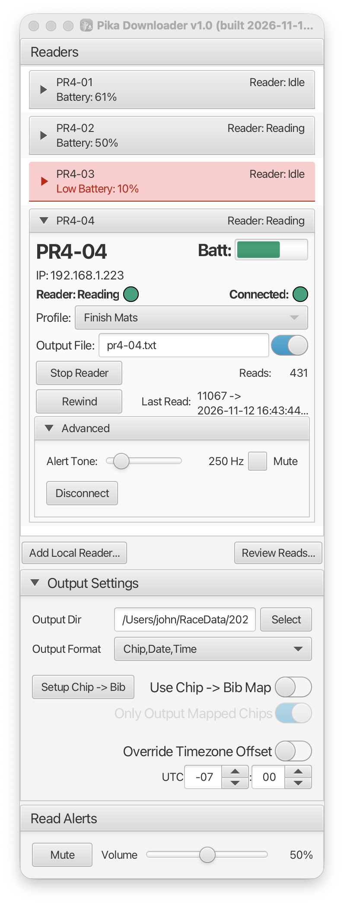
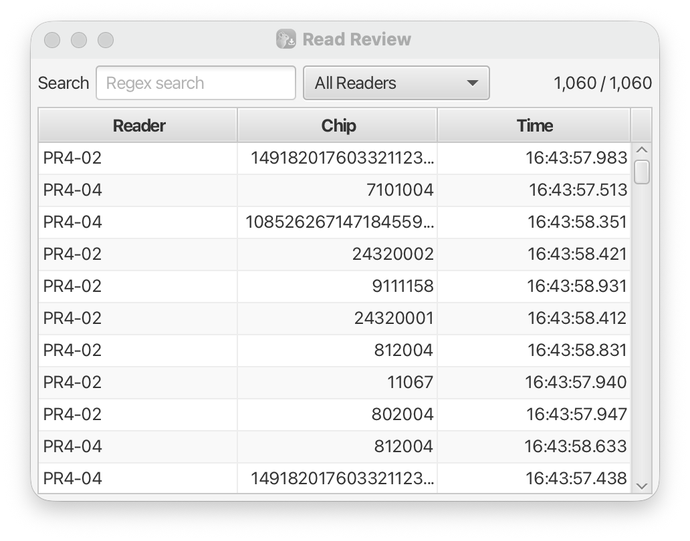

# PikaDownloader
Permits downloading timing data from a [PikaReader](https://github.com/PikaTimer/PikaReader) based system to a local text file. 

# Features
* Connects to one or more local PikaReader systems, and to remote PikaReader systems through a [PikaRelay](#remote-readers-pikarelay) server.
* Allows for saving both live read data and rewinds from a PikaReader to a local text file.
* Pre-select output format from various pre-defined basic "Chip, Date, Time" CSV file formats or use a custom output format.
* Appends new data in realtime to the output file to enable continuous importing into a timing application.
* Displays the status of the PikaReader system (last read, battery level if available, etc).
* Provides a Chip -> Bib mapping function to allow for reporting a Bib number in place of the raw chip number. Leading zeroes on chip numbers are ignored when matching. If the output includes a Bib but no Chip -> Bib map is in use, the chip number is written in its place and the Output Settings pane shows a warning.
* Optionally only outputs reads for chips that are in the Chip -> Bib map. Trigger reads (chip `0`) are always output.
* Optionally overrides the timezone offset of the reads written to the output files. Turn on "Override Timezone Offset" and pick a fixed UTC offset from -12:00 to +14:00 in 15-minute steps (the default is the computer's current offset). The date, time and timezone of each read are recomputed from its EpochMilli, which does not change. Milliseconds are kept. The Review Reads window also shows times at the override offset. The override is not saved and is off each time PikaDownloader starts.
* Optionally skews the time of one reader's reads, for a reader whose clock is off. In the reader's Advanced pane, enter a duration as `[-]HH:MM:ss[.SSS]` (for example `-00:00:02.500` makes its reads 2.5 seconds earlier) and turn the Time Skew switch on. The skew applies to the date, time and EpochMilli written to the output files, and to the Review Reads window. It does not change rewind times, which stay in the reader's own time. The duration is saved, but the switch is off each time PikaDownloader starts. While a skew is on, the collapsed reader title shows it.

# Remote Readers (PikaRelay)
A PikaReader with no direct network path to the timing computer can send its status and reads to a PikaRelay server on the internet, and PikaDownloader collects them from there.

* Open the **Remote Relay** pane and enter the relay's address (e.g. `https://relay.example.com`, or `https://example.com/relay/index.php` if the web server does not rewrite URLs). If the relay is in secure mode, also enter a **client** API key and secret from the relay's Admin page. These are saved with the other settings, and the pane shows whether the relay answers. Use `https://`, as plain `http://` sends the key and the reads unencrypted.
* Once an address is entered, **Add Remote Reader...** appears next to Add Local Reader. It lists the readers on the relay (refreshed every 5 seconds). Select one or more to add them.
* When a remote reader is added, PikaDownloader collects the reads the relay received since midnight, then polls for new reads every 2 seconds. Read alerts only play for new reads, not for that catch-up.
* A remote reader's card works like a local one, with these differences:
  * **Health:** it is based on how long ago the reader last sent its status to the relay (every 5 seconds). The card turns amber after 20 seconds and red after 120 seconds. A low battery, a disconnected RFID reader, or a bad key or secret also turns it red.
  * **Start, no stop:** a remote reader can be started but not stopped. The command goes through the relay, and the reader picks it up within about 5 seconds.
  * **Profile:** the profile can be changed while the reader is reading. The reader stops, changes the profile, and starts again. This needs a PikaReader that sends its profile list in its status.
  * **Rewind:** it can come **from the relay** (the reads the relay already has are written to the output file again) or **from the reader** (the PikaReader sends that range to the relay again, and the reads the relay was missing arrive with the next polls). Rewind times are in the reader's timezone. The relay limits a rewind from the reader to 7 days by default.
* Remote readers keep the relay settings they were added with. To move a reader to a different relay or key, remove it and add it again.

# Custom Output Formatting
By selecting "Custom" as the output format, you can specify exactly how you want the reads to be written to a file.

The system accepts a string with embeded escape codes that represent various fields you want to have displayed.

## Escape Codes
| Short Code | Long Code      | Description                 | Example Output          |
|------------|----------------|-----------------------------|-------------------------|
| B          | BIB            | Bib number                  | 1234                    |
| C          | CHIP           | Chip Number                 | 1234                    |
| DT         | DateTime       | Date and Time               | 2026-01-02 01:02:03.456 |
| D          | Date           | Date                        | 2026-01-02              |
| T          | Time           | Time w/ milliseconds        | 01:02:03.456            |
| Z or TZ    | TimeZone       | Timezone                    | -06:00                  |
| E          | EpochMilli     | Milliseconds since the EPOC | 1784481043524           |
| A          | Antenna        | Antenna Number              | 1                       |
| R          | Reader         | Reader Number               | 2                       |
| S          | RSSI           | RSSI in dBm                 | -41.2                   |

## Examples

A custom output format of **`$C,"$DT",%Z,%{EpochMilli}`** would result in the following output:
> `1234,"2026-07-19 11:10:43.524",-06:00,1784481043524`

Note that escape codes are case insensitive. You can preface the codes with either a $ or %. Codes can also be enclosed with curly brackets ({}). 
   * Example: The following are all equivalent and will print out the Chip number: `$C, %C, ${C}, %{CHIP}, ${chip}`

For Date and Time fields, you can optionaly specify a date/time formatter by enclosing the code in brackets and by separating the output code by a format string separated by a colon (:).
  * Example: `%{D:MM/dd/yyy}` would print `01/02/2026`

While the timezone override is on, the Date, Time, DateTime and TimeZone codes (including formatted ones like `%{D:MM/DD/YYYY}`) use the override offset. EpochMilli is not changed by the override. A reader's time skew moves every time code, EpochMilli included.

See the Java API docs for DateTimeFormatter at <https://docs.oracle.com/en/java/javase/25/docs/api/java.base/java/time/format/DateTimeFormatter.html#patterns)> for valid data and time formatting codes. 

## Screen Snapshots

*Main PikaDownloader UI:*

*Read Review Window:*

# Requirements
* Java 25 or newer with JavaFX 25 or newer. Installable binaries are available at <https://github.com/PikaTimer/PikaDownloader/releases>

